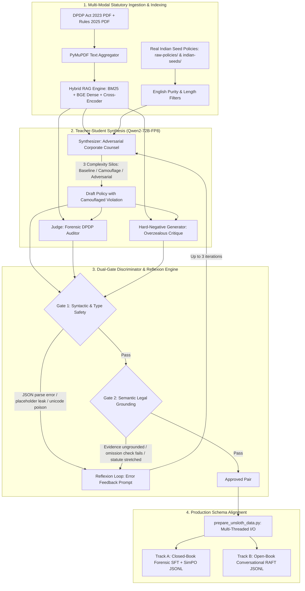
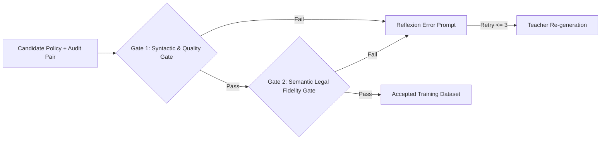

# Ssense Data Forge: Architectural Review, Teacher-Student Distillation, & Generative-Discriminative Reflexion Mechanics

This document provides a comprehensive architectural audit and academic research grounding of the **Ssense Data Forge** pipeline ([`ml/data-forge/gan_forge.py`](file:///d:/Ssense/ml/data-forge/gan_forge.py), [`prepare_unsloth_data.py`](file:///d:/Ssense/ml/data-forge/prepare_unsloth_data.py), and [`build_vector_db.py`](file:///d:/Ssense/ml/data-forge/build_vector_db.py)). 

It details the **Teacher-Student Knowledge Distillation** architecture (72B $\to$ 7B), the **Generative-Adversarial Reflexion** pipeline, and the **Dual-Gate Discriminative Filtering** mechanisms that eliminate statutory hallucinations and model collapse.

---

## 1. Architectural Overview of the Data Forge

The Data Forge operates as an autonomous data synthesis, critique, and self-healing engine. It transforms raw statutory texts (**DPDP Act 2023** and **DPDP Rules 2025**) and real-world Indian website policy seeds into rigorously verified, schema-bound training pairs for both the **Forensic Auditor** (Track A) and the **Conversational Chatbot** (Track B).



---

## 2. Teacher-Student Distillation: Training a 7B Student from a 72B Teacher

### 2.1 Theoretical Rationale for 72B $\to$ 7B Distillation
In edge-native and browser-integrated deployment, resource constraints mandate that inference models remain within the 7-billion parameter class to fit consumer VRAM/RAM budgets (~4.3 GB to 16 GB). However, base 7B models lack the internal attention capacity and parametric breadth to perform zero-shot statutory deductive reasoning across complex legal texts without severe hallucination (Dahl et al., 2024).

Conversely, high-capacity foundational models like `Qwen2-72B-Instruct` possess massive parametric depth, superior few-shot in-context reasoning, and broad statutory comprehension, but require multi-GPU server infrastructure ($\ge 80 \text{ GB}$ VRAM) that cannot be served in client browsers.

Ssense bridges this divide using **Teacher-Student Knowledge Distillation** (Mukherjee et al., 2023; Gu et al., 2024):
1. **Teacher Role (Qwen2-72B-Instruct-FP8)**: Serves as an offline oracle. It ingests the full statutory corpus via Hybrid RAG, generates realistic corporate privacy policies across three complexity silos, drafts forensic legal audits conforming to [`dpdp_schema.json`](file:///d:/Ssense/libs/contracts/schemas/dpdp_schema.json), and synthesizes hard-negative critiques for preference alignment.
2. **Student Role (Qwen2.5-7B-Instruct)**: Trained via rsLoRA ($r=128$) on the distilled, verified outputs of the 72B teacher. The student internalizes the teacher's deductive legal patterns and schema-generation abilities into compact low-rank matrices.

### 2.2 Mitigating Model Collapse (Shumailov et al., Nature 2024)
Recent research by **Shumailov et al. (Nature 2024)** (*"AI models collapse when trained on recursively generated data"*) demonstrates that training language models purely on unfiltered synthetic data leads to "model collapse" — an irreversible degenerative process where the tails of the original data distribution vanish, causing semantic repetition, loss of lexical diversity, and systemic hallucination.

The Ssense Data Forge implements three safeguards against model collapse:
1. **Real-World Empirical Anchoring**: The generator does not synthesize policies from vacuum prompts. Every generation is seeded with real policy text harvested from Indian corporate domains (`raw_policies` and `indian_seeds`), preserving authentic legal drafting variations and diverse industry terminologies.
2. **Statutory Context Grounding**: The teacher is strictly grounded at generation time with exact statutory excerpts retrieved via Hybrid RAG (`get_audit_rag_context()`), preventing the teacher from drifting into general legal platitudes.
3. **Locality-Sensitive Hashing Contamination Firewall**: Ssense executes MinHash 7-gram deduplication and a similarity buffer check (`ACCEPTED_JUSTIFICATION_BUFFER`), rejecting any generated justification that exhibits $>95\%$ string similarity to previously accepted samples.

---

## 3. The Generative-Adversarial Reflexion Pipeline

Although colloquially referenced as a "GAN Forge", the architecture in [`gan_forge.py`](file:///d:/Ssense/ml/data-forge/gan_forge.py) is mathematically formalized as an **Agentic Generative-Discriminative Loop with Verbal Reflexion** (Shinn et al., NeurIPS 2023; Madaan et al., NeurIPS 2023).

### 3.1 The Generator (Adversarial Corporate Counsel)
The generator synthesizes policy text embedded with deliberate, camouflaged statutory violations across **six target industries** (Tech, Finance, Healthcare, E-Commerce, Education, Telecom) and **three cognitive complexity silos**:

- **Silo 1: Baseline (30% Distribution)**: Standard corporate phrasing where the statutory breach is clear and unambiguous.
- **Silo 2: Camouflage (50% Distribution)**: Complex corporate legalese where the illegal command is framed as a user-centric benefit (e.g., claiming secondary data monetization is an "inherent aspect of service continuity").
- **Silo 3: Adversarial Cognitive Overload (20% Distribution)**: Dense, run-on sentences with technical jargon designed to disorient automated parsers while preserving an undeniable illegal corporate directive.

The generator applies **20 distinct camouflaged violation techniques** (e.g., *Legitimate Use Overreach*, *Implied Consent Trap*, *Silent Deletion Protocol*, *Global Infrastructure Veil*, *Nominee Invalidation*).

---

### 3.2 The Hard-Negative Generator (Overzealous Auditor)
To train the student model using preference optimization (SimPO), the pipeline requires high-quality `rejected` samples.

The Hard-Negative Generator produces audits that simulate typical LLM failure modes:
1. **Exemption Traps**: Falsely flags legal exemptions as violations. For example, Section 17(1)(c) permits processing without consent during medical emergencies; Section 17(2)(b) permits permanent retention of de-identified data for research. The hard-negative generator creates audits that falsely prosecute these valid exemptions.
2. **Commentary Traps & Speculation**: Generates violations based on speculative future risks rather than printed text.
3. **Statute Misattribution**: Alleges an actual violation but cites an unrelated section (e.g., citing Section 9 Children's Consent for an adult data retention breach).

---

### 3.3 The Dual-Gate Discriminator

Every candidate policy and audit pair must pass through two independent evaluation gates before being accepted into the dataset:



#### Gate 1: Syntactic & Type Safety Verification
- **JSON Structure & Repair Cascade**: Robust multi-pass parser (`json.loads` $\to$ `yaml.safe_load` $\to$ `json_repair.loads`) stripping trailing commas and resolving unescaped inner quotation marks.
- **Strict Bounds Verification**: Enforces that `dpdp_trust_score` and `subtlety_score` are strictly integers in $[0, 100]$.
- **String Poison & Placeholder Firewall** (`check_string_poison`): Rejects any text containing template placeholders (`[insert company name]`, `<address>`, `{tbd}`), leaked XML tags (`<section>`, `</section>`), prompt directives (`[task]`, `contains_trap`), or unicode corruption artifacts (`\ufffd`, `\u200b`).
- **Character Purity**: Purges non-breaking spaces (`\xa0`) and strips whitespace recursively across all keys and values.

#### Gate 2: Semantic Legal Fidelity Verification
- **Verbatim Evidence Grounding** (`is_quote_in_policy`): Checks that the `evidence_quote` exists verbatim in the generated policy text using an exact normalized match, sliding-window SequenceMatcher ($>0.65$ ratio), and token intersection ($>0.80$). This prevents the model from hallucinating non-existent quotes.
- **The Omission Check Gate**: Strictly validates that `omission_check == False`. Bans all forbidden omission phrases (*"fails to specify"*, *"does not provide"*, *"silent on"*, *"lacks specific"*) and regex word boundaries (`\b(fails|failing|lacks|omits|failure)\b`).
- **16-Category Statute Stretching Firewall**: Enforces strict statutory mappings. For example:
  - `PURPOSE_LIMITATION_VIOLATION` $\implies$ MUST cite **Section 4**.
  - `CONSENT_NOT_FREE_OR_SPECIFIC` $\implies$ MUST cite **Section 6** or **Rule 3**.
  - `CHILD_CONSENT_VIOLATION` $\implies$ MUST cite **Section 9**.
  - `DATA_RETENTION_LIMIT_EXCEEDED` $\implies$ MUST cite **Section 8(7)** or **Rule 8**.
  - `CROSS_BORDER_TRANSFER_VIOLATION` $\implies$ MUST cite **Section 16** or **Rule 15**.
- **Safe Harbor Enforcer**: Blocks audits that falsely flag anonymized, de-identified, or aggregated research data as violations.
- **Administrative Immunity Guard** (`is_administrative_element`): Protects standard corporate contact blocks (grievance officer emails, phone numbers, registered corporate addresses) from being flagged as privacy breaches.

---

### 3.4 Self-Healing Reflexion Loops (Iterative Verbal Feedback)
If a generated candidate fails either Gate 1 or Gate 2, the pipeline does not discard the compute cycle immediately. Instead, it implements the **Reflexion** paradigm (**Shinn et al., NeurIPS 2023**):

1. The exact failure reason (e.g., `SFT Error: Evidence quote not strictly found in policy` or `DPO Error: Omission hallucination detected`) is captured.
2. A structured verbal feedback prompt ([`reflexion_explicit_prompt.txt`](file:///d:/Ssense/ml/data-forge/prompts/reflexion_explicit_prompt.txt)) is compiled, containing:
   - The failed policy text.
   - The target violation objective.
   - The specific discriminator error message.
   - The required complexity directive.
3. The teacher model receives this feedback and iteratively rewrites the policy to repair the defect.
4. This cycle executes for up to **$3$ iterative correction steps** (`MAX_REFLEXION_STEPS = 3`), converting marginal failures into compliant training pairs.

---

## 4. Academic Literature Grounding for the Data Forge

The table below lists the formal academic literature supporting each component of the Ssense Data Forge:

| Paper / Framework | Authors / Citation | Venue | Methodological Nexus with Ssense Data Forge |
| :--- | :--- | :---: | :--- |
| **Reflexion: Language Agents with Verbal Reinforcement Learning** | Shinn, Cassano, Gopinath, Narasimhan, & Yao (2023) | **NeurIPS 2023** | Theoretical foundation for Ssense's iterative self-healing feedback loops (`MAX_REFLEXION_STEPS=3`). |
| **Self-Refine: Iterative Refinement with Self-Feedback** | Madaan et al. (2023) | **NeurIPS 2023** | Demonstrates that providing explicit critique feedback to language models enables multi-turn correction of generated outputs. |
| **MiniLLM: Knowledge Distillation of Large Language Models** | Gu, Dong, Wei, & Huang (2024) | **ICLR 2024** | Formulates knowledge transfer from large teacher models to small student models, minimizing student distribution divergence. |
| **Orca: Progressive Learning from Complex Explanation Traces** | Mukherjee et al. (Microsoft, 2023) | arXiv:2306.02707 | Shows that training 7B/13B models on step-by-step reasoning traces from high-capacity teachers (GPT-4) enables student models to acquire complex reasoning capabilities. |
| **UltraFeedback: Boosting Language Models with Scaled AI Feedback** | Cui et al. (2024) | **ICML 2024** | Establishes multi-dimensional automated critique and filtering for preference dataset construction. |
| **AI Models Collapse when Trained on Recursively Generated Data** | Shumailov et al. (2024) | **Nature 2024** | Proves the necessity of grounding synthetic data generation in real-world seeds (`raw_policies`) to avoid distribution collapse. |
| **Self-Instruct: Aligning Language Models with Self-Generated Instructions** | Wang et al. (2023) | **ACL 2023** | The foundational generate–filter–finetune framework underlying Ssense's synthetic data pipeline. |
| **Constitutional AI: Harmlessness from AI Feedback** | Bai et al. (Anthropic, 2022) | arXiv:2212.08073 | Establishes rule-based critique and revision without human-in-the-loop annotations, matching Ssense's statutory rule filters. |

---

## 5. Academic Framing: Data Format Nomenclature

In formal peer-reviewed publications (IEEE, ACM, Springer), training data should be described using standard machine learning and natural language processing terminology rather than proprietary framework branding:

| Industrial / Implementation Term | Formal Academic Nomenclature for Research Papers |
| :--- | :--- |
| *"Unsloth type of data"* / *"Unsloth JSONL"* | **ChatML-formatted causal language modeling corpus with response-only cross-entropy loss masking** |
| *"DPO dataset"* / *"DPO JSONL"* | **Binarized preference dataset for reference-free alignment (SimPO) with target reward margins** |
| *"GAN Forge"* | **Agentic Generative-Discriminative Synthesis Loop with Verbal Reflexion and Multi-Gate Verification** |
| *"Teacher-Student 72B $\to$ 7B"* | **Cross-Scale Knowledge Distillation from a 72B Foundation Model to an Edge-Deployable 7B Parameter SLM** |
| *"Hard Negative Prompt"* | **Targeted Adversarial Hard-Negative Mining for Statutory Hallucination Mitigation** |
| *"Golden Seeds"* | **1-Shot Exemplar Anchors for In-Context Generation and Syntactic Structure Guidance** |

---

## 6. Bibliographic Entries (Ready for Paper Insertion)

```bibtex
% --- Teacher-Student Distillation & Synthetic Data ---

@inproceedings{gu2024minillm,
  title={Mini{LLM}: Knowledge Distillation of Large Language Models},
  author={Gu, Yuxian and Dong, Li and Wei, Furu and Huang, Minlie},
  booktitle={The Twelfth International Conference on Learning Representations (ICLR)},
  year={2024},
  url={https://openreview.net/forum?id=6ca90u0WS0}
}

@article{mukherjee2023orca,
  title={Orca: Progressive learning from complex explanation traces of {GPT-4}},
  author={Mukherjee, Subhabrata and Mitra, Arindam and Jawahar, Ganesh and Agarwal, Sahaj and Palangi, Hamid and Awadallah, Ahmed},
  journal={arXiv preprint arXiv:2306.02707},
  year={2023}
}

@inproceedings{wang2023selfinstruct,
  title={Self-Instruct: Aligning Language Models with Self-Generated Instructions},
  author={Wang, Yizhong and Kordi, Yeganeh and Mishra, Swaroop and Liu, Alisa and Smith, Noah A and Khashabi, Daniel and Hajishirzi, Hannaneh},
  booktitle={Proceedings of the 61st Annual Meeting of the Association for Computational Linguistics (ACL)},
  pages={13484--13508},
  year={2023},
  doi={10.18653/v1/2023.acl-long.754}
}

@inproceedings{cui2024ultrafeedback,
  title={{ULTRAFEEDBACK}: Boosting Language Models with Scaled {AI} Feedback},
  author={Cui, Ganqu and Yuan, Lifan and Ding, Ning and Yao, Guanming and He, Bingxiang and Zhu, Wei and Ni, Yuan and Xie, Guotong and Xie, Ruobing and Lin, Yankai and Liu, Zhiyuan and Sun, Maosong},
  booktitle={Proceedings of the 41st International Conference on Machine Learning (ICML)},
  pages={9722--9744},
  year={2024}
}

% --- Reflexion & Self-Correction ---

@inproceedings{shinn2023reflexion,
  title={Reflexion: language agents with verbal reinforcement learning},
  author={Shinn, Noah and Cassano, Federico and Gopinath, Ashwin and Narasimhan, Karthik and Yao, Shunyu},
  booktitle={Advances in Neural Information Processing Systems (NeurIPS)},
  volume={36},
  pages={8634--8646},
  year={2023}
}

@inproceedings{madaan2023selfrefine,
  title={{Self-Refine}: Iterative Refinement with Self-Feedback},
  author={Madaan, Aman and Tandon, Niket and Gupta, Prakhar and Hallinan, Skyler and Gao, Luyu and Wiegreffe, Sarah and Alon, Uri and Dziri, Nouha and Prabhumoye, Shrimai and Yang, Yang and Gupta, Shashank and Majumder, Bodhisattwa Prasad and Hermann, Katherine and Welleck, Sean and Yazdanbakhsh, Amir and Clark, Peter},
  booktitle={Advances in Neural Information Processing Systems (NeurIPS)},
  volume={36},
  year={2023}
}

% --- Model Collapse Pathology ---

@article{shumailov2024ai,
  title={{AI} models collapse when trained on recursively generated data},
  author={Shumailov, Ilia and Shumaylov, Zakhar and Zhao, Yiren and Papernot, Nicolas and Anderson, Ross and Gal, Yarin},
  journal={Nature},
  volume={631},
  number={8022},
  pages={755--759},
  year={2024},
  doi={10.1038/s41586-024-07566-y}
}
```
