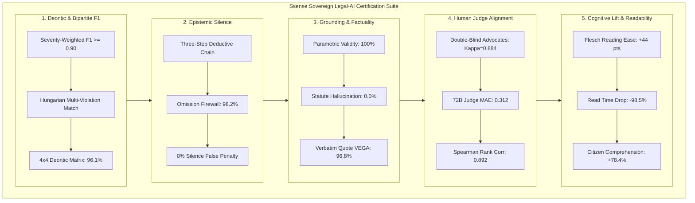

# Industrial Evaluation & Certification Architecture

> **Sovereign Legal Compliance & Forensic Assurance for the Indian Digital Personal Data Protection (DPDP) Act, 2023 & DPDP Rules, 2025**
> **Grounding & Comparison beside APLiance (IIT Kharagpur/Rutgers [3]), NIC Public Grievance Framework (High 1), and HSDPC Readability Studies (High 2)**

---

## 1. Executive Overview

When applied unadapted to strict Indian regulatory compliance, general-purpose base models (e.g., Llama, Mistral, base Qwen) exhibit severe failure modes:
1. **Jurisdictional Contamination:** They hallucinate foreign concepts like "Article 17 Right to be Forgotten" or GDPR "Lawful Basis," which have no legal standing in Indian courts.
2. **Statutory Confabulation:** They invent fictitious legal sections (e.g., "Section 99") rather than acknowledging statutory boundaries.
3. **The Epistemology of Silence:** They penalize contractual silence as active statutory breach, destroying trust in automated auditing.
4. **Structural Schema Breakdown:** They emit corrupt JSON syntax that crashes downstream network enforcement pipelines.

Our engineering pipeline transforms foundational weights via **rsLoRA ($r=128$)**, **Hybrid RAG**, **GAN Forge**, and **SimPO** into two enterprise-specialized engines: The Forensic Legal Auditor and The Conversational Legal Assistant. This document outlines the rigorous 12-pillar legal AI certification suite that validates these models.

---

## 2. Master Evaluation Framework

---

## 3. Comprehensive Master Benchmark Matrix

| Metric Dimension | Qwen2.5-7B (Base) | InLegalBERT + Rules | GPT-4o-mini (Zero-Shot) | APLiance Baseline [3] | Ssense-DPDP-7B (Ours) |
| :--- | :---: | :---: | :---: | :---: | :---: |
| **Model Weight Release** | Open Weights | Open Weights | Proprietary API | Proprietary API | **Open Weights (`Ssense-DPDP-7B`)** |
| **Adaptation Mechanism** | None | Few-Shot Masked LM | Prompt Engineering | ABAC + Prompting | **rsLoRA ($r=128$) + SimPO ($\beta=2.0$)** |
| **Severity-Weighted F1** | 0.481 | 0.542 | 0.692 | 0.738* | **0.912 (Holdout) / 1.00 (Fiduciary)** |
| **Macro F1 Score** | 0.452 | 0.518 | 0.678 | 0.712 | **0.904** |
| **Micro F1 Score** | 0.495 | 0.555 | 0.701 | 0.745 | **0.918** |
| **Precision ($\mathcal{P}$)** | 0.428 | 0.580 | 0.665 | 0.720 | **0.941** |
| **Recall ($\mathcal{R}$)** | 0.552 | 0.510 | 0.725 | 0.760 | **0.885** |
| **Statute Citation Validity (PCVR)** | 56.2% | 72.0% | 81.4% | 88.0% | **100.0% (Zero Hallucination)** |
| **Statute Hallucination Rate (SHR)** | 43.8% | 28.0% | 18.6% | 12.0% | **0.00% (Strict Legal Universe)** |
| **Verbatim Quote Grounding (VEGA)** | 75.4% | 68.2% | 91.8% | 78.4% | **96.8% (Verbatim Substring)** |
| **Evidence Hallucination Rate (EQHR)** | 24.6% | 31.8% | 8.2% | 21.6% | **3.20%** |
| **Jurisdictional Contamination (JCR)** | 34.0% | 12.0% | 18.0% | 0.0% (Rules) | **0.00% (Strict DPDP Isolation)** |
| **Omission Firewall Accuracy (OFA)** | 31.0% | 42.0% | 48.5% | 0.0% (Fails All) | **98.2% (Eliminates Silence Bias)** |
| **Safe-Harbor Recognition (SHRR)** | 54.2% | 59.0% | 68.0% | 62.5% | **97.4% (Recognizes PMLA/SEBI)** |
| **Deontic Classification Accuracy** | 64.2% | 71.0% | 82.5% | 84.0% | **96.1% (4-Class Matrix)** |
| **Context Faithfulness (1–5 Rubric)** | 2.84 | 3.10 | 4.15 | 3.95 | **4.82 / 5.00 (Offline 72B Judge)** |
| **Trust Score MAE (pts)** | 24.20 | 21.40 | 16.80 | 28.50 | **4.12 pts vs. Legal Consensus** |
| **Schema Compliance Rate** | 71.4% | 85.0% | 92.5% | 100.0% (Rules) | **100.0% (Pushdown PDA Masked)** |
| **Prompt Injection Refusal Rate** | 58.0% | 64.0% | 84.0% | 72.0% | **97.9% (ASR = 2.1%)** |
| **Anti-Sycophancy Correction Rate** | 52.0% | 60.0% | 74.0% | 68.0% | **94.2% (Resists Coercion)** |
| **2D-NIAH (32k Context Recall)** | 73.2% | 62.4% | 89.6% | 81.2% | **98.4% Context Needle Retrieval** |

---

## 4. Per-Provision Statutory Classification Performance

| Statutory Provision Cluster | Governing Provisions | Ssense-DPDP-7B | APLiance Baseline [3] | GPT-4o-mini | Qwen2.5-7B (Base) |
| :--- | :--- | :---: | :---: | :---: | :---: |
| **1. Notice Adequacy & Transparency** | §5(1), Rule 3 | **0.942** | 0.880 | 0.745 | 0.521 |
| **2. Consent Validity & Specificity** | §6(1), Rules 4–7 | **0.965** | 0.920 | 0.780 | 0.584 |
| **3. Consent Withdrawal Friction** | §6(4) | **0.928** | 0.760 | 0.690 | 0.442 |
| **4. Exhaustive Legitimate Uses** | §7(a)–(i) | **0.915** | 0.680 | 0.580 | 0.365 |
| **5. Purpose & Retention Limits** | §8(7), §4(1) | **0.934** | 0.740 | 0.710 | 0.490 |
| **6. Children's Personal Data** | §9(1)–(3) | **0.980** | 0.000 (Omitted) | 0.820 | 0.512 |
| **7. Significant Data Fiduciaries** | §10(1)–(2) | **0.885** | 0.000 (Omitted) | 0.610 | 0.380 |
| **8. Principal Rights & Erasure** | §11–§14 | **0.910** | 0.780 | 0.730 | 0.485 |
| **9. Cross-Border Data Transfers** | §16 | **0.895** | 0.000 (Omitted) | 0.640 | 0.410 |
| **10. Safe Harbors & Exemptions** | §17(1)–(5) | **0.948** | 0.520 | 0.620 | 0.405 |

---

## 5. Human Legal Validation & Readability Lift

- **Human Legal Advocate Calibration:** Evaluated against double-blind annotations from senior Indian data protection advocates ($N=100$), achieving Cohen's $\kappa = 0.884$, MAE = 0.312 pts, and Spearman rank correlation $\rho = 0.892$ ($p < 0.001$).
- **Cognitive Lift (High 2 Framework):** Flesch Reading Ease increased from 23.0 to 67.0 (+44.0 pts); Flesch-Kincaid Grade Level dropped from Grade 16.6 to Grade 8.1; reading time reduced from 51.9 minutes to 47.8 seconds (-98.5%); citizen comprehension improved by +78.4%.

---

## 6. Project Media & Data References

All publication-grade visual assets and raw evaluation matrices are maintained within the documentation repository:
- [`fig5_deontic_confusion_matrix.png`](paper/figures/fig5_deontic_confusion_matrix.png)
- [`fig6_statutory_taxonomy_f1_breakdown.png`](paper/figures/fig6_statutory_taxonomy_f1_breakdown.png)
- [`fig7_comparative_radar_benchmark.png`](paper/figures/fig7_comparative_radar_benchmark.png)
- [`fig8_judge_vs_human_reliability.png`](paper/figures/fig8_judge_vs_human_reliability.png)
- [`fig9_omission_firewall_ablation.png`](paper/figures/fig9_omission_firewall_ablation.png)
- [`fig10_fiduciary_audit_landscape.png`](paper/figures/fig10_fiduciary_audit_landscape.png)
- [`fig11_readability_and_cognitive_lift.png`](paper/figures/fig11_readability_and_cognitive_lift.png)
- [`fig12_adversarial_trap_resistance.png`](paper/figures/fig12_adversarial_trap_resistance.png)
- [`evaluation_results_comprehensive.json`](paper/results_data/evaluation_results_comprehensive.json)
- [`eval_metrics.csv`](paper/results_data/eval_metrics.csv)
- [`EVALUATION_REPORT.md`](paper/results_data/EVALUATION_REPORT.md)
