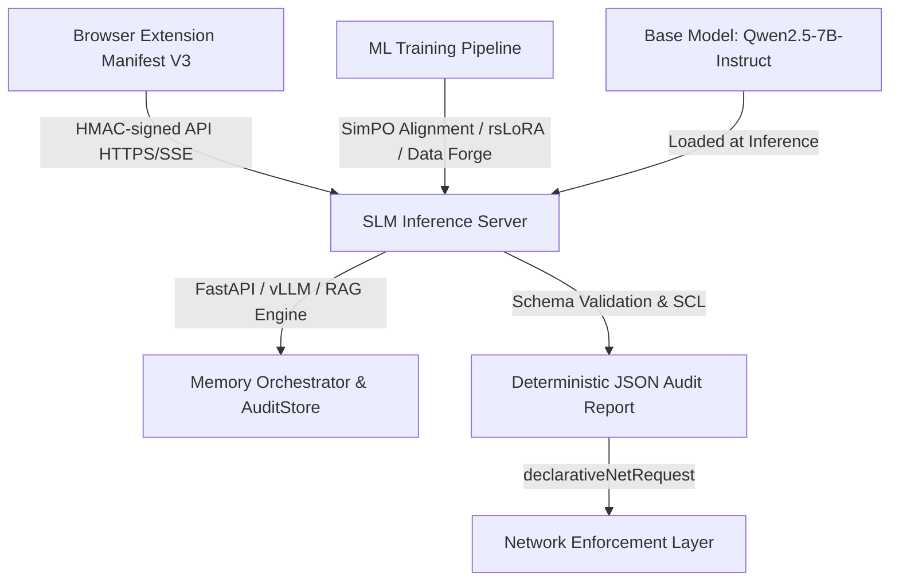
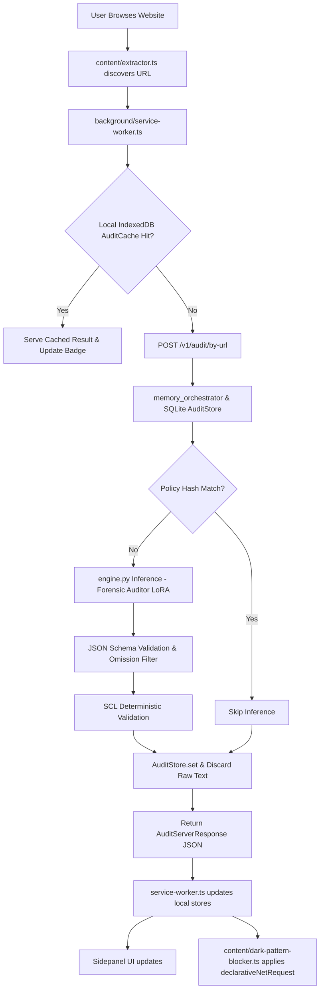

# Methodology: Ssense — A Browser-Native DPDP Act 2023 Compliance Auditing System

> **Research Paper Companion Document**
> Version: 1.0 · September 2026

---

## Table of Contents

1. [System Overview & Problem Statement](#1-system-overview--problem-statement)
2. [Architectural Paradigm](#2-architectural-paradigm)
3. [Stage 1: Legal Data Engineering & Synthetic Dataset Synthesis](#3-stage-1-legal-data-engineering--synthetic-dataset-synthesis)
4. [Stage 2: Small Language Model Training & Alignment](#4-stage-2-small-language-model-training--alignment)
5. [Stage 3: Functional & Adversarial Model Certification](#5-stage-3-functional--adversarial-model-certification)
6. [Stage 4: SLM Inference Server Design](#6-stage-4-slm-inference-server-design)
7. [Stage 5: Privacy Policy Extraction Pipeline](#7-stage-5-privacy-policy-extraction-pipeline)
8. [Stage 6: The Audit Schema & Enforcement Protocol](#8-stage-6-the-audit-schema--enforcement-protocol)
9. [Stage 7: Browser Extension Architecture](#9-stage-7-browser-extension-architecture)
10. [Stage 8: Network Enforcement Layer](#10-stage-8-network-enforcement-layer)
11. [Stage 9: Cross-Device Synchronization Protocol](#11-stage-9-cross-device-synchronization-protocol)
12. [Stage 10: Security & Anti-Extraction Hardening](#12-stage-10-security--anti-extraction-hardening)
13. [Stage 11: Audit History & Visualization UI](#13-stage-11-audit-history--visualization-ui)
14. [Stage 12: Conversational AI Co-Pilot](#14-stage-12-conversational-ai-co-pilot)
15. [End-to-End Data Flow](#15-end-to-end-data-flow)
16. [Deployment & Infrastructure](#16-deployment--infrastructure)
17. [Evaluation Metrics Summary](#17-evaluation-metrics-summary)

---

## 1. System Overview & Problem Statement

**Ssense** is a domain-adapted Legal Language Model (Law-LM / Legal SLM) architecture and browser-native enforcement system that performs automated, real-time compliance auditing of website privacy policies against India's **Digital Personal Data Protection (DPDP) Act 2023** and its procedural **Rules 2025**. Under **Section 3(b)** of the Act, data protection mandates apply extraterritorially to web platforms worldwide that process personal data or profile Indian data principals. Ssense operates passively at the citizen's browser endpoint—verifying the statutory authenticity of global web declarations—and autonomously enforces confirmed violations directly at the network layer.

### Core Problem & Research Motivation

Existing approaches to privacy policy auditing suffer from four critical deficiencies:

1. **Global Web Inauthenticity & Extraterritorial Evasion**: Foreign platforms routinely present generic global privacy policies (often drafted for GDPR or US FTC safe harbors) that mask systemic non-compliance with mandatory Indian statutory duties (e.g., multilingual notices, unconditional withdrawal parity, strict child tracking bans).
2. **Statutory Hallucination & Jurisdictional Bias**: General-purpose LLMs produce fabricated statute references, invent non-existent legal duties, and superimpose foreign legal doctrines onto Indian sovereign statutes.
3. **Epistemic Silence Fallacy**: Prior automated checkers (e.g., APLiance) penalize legal silence indiscriminately, assuming any unstated practice is an automatic violation and causing 100% of real-world policies to fail compliance.
4. **No Mechanical Enforcement**: Prior compliance tools function purely as advisory summaries, leaving browser network traffic completely unmitigated.

Ssense addresses these foundational challenges by combining a **domain-aligned Small Language Model (SLM)** (`Qwen2.5-7B-Instruct` + rsLoRA + SimPO), a **26-node statutory decision tree**, an **epistemic omission firewall**, a **deterministic neuro-symbolic Statutory Compliance Layer ($V_{\text{final}} = V_{\text{SLM}} \cup V_{\text{SCL}}$)**, and an **autonomous network enforcement engine** that translates legal findings into browser-level countermeasures.


---

## 2. Architectural Paradigm

The system is decomposed into four independently deployable layers:



The system deliberately separates concerns: the extension contains **zero model weights** and **zero raw policy text**. All inference happens server-side; only compact JSON audit reports are transmitted back to the client.

---

## 3. Stage 1: Legal Data Engineering & Synthetic Dataset Synthesis

### 3.1 Source Corpus

The primary legal corpus comprises:
- **DPDP Act 2023** (Official Gazette of India)
- **Draft DPDP Rules 2025**
- A curated statutory reference corpus (`dpdp_act_and_rules_2025.txt`) covering all 44 sections and 22 rules, with inter-section cross-references hand-mapped.

### 3.2 Hybrid Legal RAG Index (`build_vector_db.py`)

A hybrid retrieval system is constructed offline to serve the synthetic data generation pipeline:

1. **BM25 Okapi**: Sparse keyword retrieval using exact statutory terminology and section numbering.
2. **Dense BGE Embeddings** (`BAAI/bge-large-en-v1.5`): Semantic similarity retrieval in BF16 precision on BF16 Tensor Cores.
3. **Cross-Encoder Reranker** (`BAAI/bge-reranker-v2-m3`): Re-ranks the top-K candidates from BM25 and dense retrieval using relevance scoring.
4. **O(N) Top-K argpartitioning**: Bypasses full-array sorting for sub-millisecond extraction at query time.
5. **LRU Embedding Cache** (2048-entry bounded LRU): Instantly serves repeated semantic queries without re-encoding.

The combined index is serialized to `dpdp_hybrid_index.pkl` using safetensors for embedding matrix storage.

### 3.3 Teacher-Student Distillation & Agentic Reflexion Forge (`gan_forge.py`)

A **Generative-Discriminative Reflexion pipeline** is implemented using `Qwen2-72B-Instruct-FP8` as the teacher model, formalizing knowledge distillation from intermediate reasoning traces (Mukherjee et al., 2023; Gu et al., ICLR 2024):

- **Generator (Adversarial Corporate Counsel)**: The 72B teacher receives real policy seeds and retrieved statutory context to synthesize realistic policies across three cognitive complexity silos (30% Baseline, 50% Camouflage, 20% Adversarial Traps).
- **Orca Deductive Traces**: The teacher generates structured reasoning across three steps (`step_1_active_claim_analysis`, `step_2_statute_match`, `step_3_semantic_justification`), ensuring the student SLM learns causal statutory deduction rather than memorizing labels (Mukherjee et al., 2023).
- **Dual-Gate Discriminator & Verbal Reflexion**: Output is audited through two gates:
  1. *Gate 1 (Syntactic & Quality)*: Rejects JSON syntax errors, template placeholder leaks, and Unicode corruption (`\ufffd`, `\u200b`).
  2. *Gate 2 (Semantic Legal Grounding)*: Verifies verbatim quote existence (`is_quote_in_policy`), enforces the omission gate (`omission_check: false`), and restricts citations to the valid DPDP universe ($1 \le \text{Section} \le 44$).
  Failed samples are healed via a multi-turn verbal feedback loop (up to $k=3$ iterations) adhering to the Reflexion framework (Shinn et al., NeurIPS 2023; Madaan et al., NeurIPS 2023).
- **Model Collapse Mitigation**: Seeding generation with authentic Indian corporate policies (`raw-policies/`, `indian-seeds/`) and statutory source truth prevents recursive distribution collapse and preserves lexical tail diversity (Shumailov et al., *Nature* 2024).
- **Loophole Injection & SimPO Pairs**: An adversarial pass introduces subtle compliance weaknesses to generate hard-negative "rejected" responses, creating paired preference data for reference-free alignment (Meng et al., NeurIPS 2024).

### 3.4 Deterministic Decision Tree & 26/44 Statutory Pruning (`build_dpdp_tree.py`)

The DPDP Act comprises 44 sections, but not all govern Data Fiduciaries directly. Ssense employs a strict bureaucratic firewall, mechanically excluding administrative provisions ($\mathcal{S}_{\text{admin}}$ in Sections 18–26, $\mathcal{S}_{\text{tribunal}}$ in Sections 29–32 and 34–44). The remaining actionable sections are mapped into a strict taxonomy of **26 distinct violation phenotypes** (e.g., `CONSENT_NOT_FREE_OR_SPECIFIC`, `DATA_RETENTION_LIMIT_EXCEEDED`). This 26/44 convergence ensures the SLM concentrates its attention heads exclusively on enforceable data privacy rules. FSM-constrained decoding (Willard & Louf, 2023) compiles `dpdp_act_tree.json` with deterministic schema guarantees, binding citations and network actions.

### 3.5 Hybrid Legal RAG Context Convergence (`build_vector_db.py`)

To provide grounded legal knowledge, we constructed an authoritative index of 237 statutory chunks.
The pipeline operates as follows:
1. **Header-Preserving Chunking**: The raw legal corpus is split on structural headers (Sections, Rules) using a `RecursiveCharacterTextSplitter`. Sub-chunks retain their parent headers to maintain legal context.
2. **Dual-Index Generation**: A Lexical BM25 Okapi index ($k_1=1.5, b=0.75$) captures exact statutory phrasing, while a Dense BGE vector index (`BAAI/bge-large-en-v1.5`) captures semantic intent.
3. **Retrieval Convergence & Re-Ranking**:
   At inference, retrieval aggregates sparse and dense rankings via Reciprocal Rank Fusion (Cormack et al., SIGIR 2009) or normalized convex combination:
   $$ S_{hybrid}(q, c) = \alpha \cdot \text{norm}(S_{BM25}(q, c)) + (1 - \alpha) \cdot \text{norm}(S_{BGE}(q, c)) $$
   followed by cross-encoder re-ranking (`BAAI/bge-reranker-v2-m3`). Zero-copy memory mapping via `.safetensors` enables instant initialization.

### 3.6 Dataset Formatting & Leaky-Split Firewall (`prepare_unsloth_data.py`, `check_data_leakage.py`)

- Formats all training pairs into **ChatML** causal language modeling structures.
- Applies **response-only masking**: only the assistant turn is included in the loss computation ($-\frac{1}{N} \sum \log P(x_i \mid x_{<i})$) to prevent the model from learning prompt-formatting artifacts.
- A **MinHash 7-Gram Contamination Firewall** (`check_data_leakage.py`) computes Jaccard similarity between train and eval splits at the 7-gram level using 128 LCG permutations (Broder, 1997; Lee et al., ACL 2022). A strict hard-fail gate ($J \le 0.85$) guarantees zero train-eval leakage.

---

## 4. Stage 2: Small Language Model Training & Alignment

Two domain-specialized SLMs are trained on a single **Qwen2.5-7B-Instruct** base model as hot-swappable LoRA adapters. For an exhaustive parameter-by-parameter audit and theoretical derivation, see [`docs/TRAINING_RESEARCH_GROUNDING.md`](file:///d:/Ssense/docs/TRAINING_RESEARCH_GROUNDING.md) and [`docs/citations.md`](file:///d:/Ssense/docs/citations.md).

### 4.1 Model Specialization Matrix

| Property | Forensic Auditor | Conversational Chatbot | Research Grounding |
|---|---|---|---|
| **Artifact name** | `audit-model-final-adapter` | `chatbot-model-final-adapter` | Multi-LoRA vLLM Serving |
| **Task** | Privacy policy forensic auditing → validated JSON | Citizen guidance & data rights dialogue | Specialized Dual-Track PEFT |
| **Context window** | 8,192 tokens | 4,096 tokens | RoPE $\theta=10^6$ (Su et al., 2024; Dao, 2024) |
| **Output format** | Strict `dpdp_schema.json` | High-fluidity Markdown | Guided XGrammar Decoding |
| **LoRA rank / alpha** | rsLoRA $r=128$, $\alpha=128$ (effective scale $\approx 11.31$) | rsLoRA $r=64$, $\alpha=16$ (effective scale $=2.0$) | Kalajdzievski (arXiv:2312.03732) |
| **LoRA targets** | All 7 linear layers (`q, k, v, o, gate, up, down`) | All 7 linear layers (`q, k, v, o, gate, up, down`) | QLoRA (Dettmers et al., NeurIPS 2023) |
| **Learning rate (SFT / SimPO)** | $1.5 \times 10^{-5}$ / $5.0 \times 10^{-6}$ | $1.5 \times 10^{-5}$ / $5.0 \times 10^{-6}$ | Cosine with min LR ($\eta_{\min}=0.1$) |
| **Optimizer & Weight Decay** | `adamw_torch_fused` (FP32 states, decay=0.05) | `adamw_torch_fused` (FP32 states, decay=0.05) | Loshchilov & Hutter (ICLR 2019) |
| **NEFTune noise ($\alpha$)** | 5.0 (embedding regularization) | 5.0 (conversational anti-memorization) | Jain et al. (ICLR 2024) |
| **SimPO beta / gamma** | $\beta=2.0$, $\gamma=0.5$ (zero-hallucination mandate) | $\beta=1.0$, $\gamma=0.5$ (conversational RAFT) | Meng, Xia, & Chen (NeurIPS 2024) |

### 4.2 Hardware Platform

Training was performed on **NVIDIA DGX Spark (Grace-Blackwell GB10)** with:
- CUDA 13.0 / Compute Capability `sm_121` (forward-compatible with `sm_120`)
- PyTorch `2.11.0` (`cu130`) in native **BF16 precision** (Kalamkar et al., 2019)
- Unsloth `2026.8` with Triton Fused kernels for attention, RoPE, and cross-entropy loss
- `use_gradient_checkpointing="unsloth"` reducing activation memory from $\mathcal{O}(N)$ to $\mathcal{O}(\sqrt{N})$ (Chen et al., 2016)

A **VRAM Airlock** pattern is enforced via OS-level process isolation (`multiprocessing.Process(..., start_method="spawn")`): the Stage 1 SFT process exits completely, destroying the CUDA context and releasing 100% of physical GPU VRAM before Stage 2 SimPO initializes.

### 4.3 Phase 1: Supervised Fine-Tuning (SFT) with rsLoRA

- **Rank-Stabilized Scaling (rsLoRA)**: Conventional LoRA scales updates by $\alpha/r$, which collapses at $r=128$ because the Frobenius norm grows as $\mathcal{O}(\sqrt{r})$, causing an effective update rate of $\mathcal{O}(1/\sqrt{r})$. rsLoRA replaces this with:
  $$\Delta W = \frac{\alpha}{\sqrt{r}} (B \cdot A)$$
  maintaining constant learning dynamics across scaling (Kalajdzievski, 2023).
- **Target Module Coverage**: All seven linear projections (`q_proj, k_proj, v_proj, o_proj, gate_proj, up_proj, down_proj`) are adapted, matching full fine-tuning expressiveness (Dettmers et al., 2023; Wu & Ma, 2025).
- **Response-Only Loss Masking**: Cross-entropy loss is computed exclusively on the assistant tokens (`train_on_responses_only`) with user/system prompt tokens masked as `-100`.
- **Pre-Training Token Firewall**: Sequences exceeding 8,192 tokens are filtered prior to batching, preventing TRL's right-truncation from amputating closing JSON schema brackets.
- **Ungrounded Citation Trip-Wire**: Pre-flight verification aborts training if $>5\%$ of statutory citations in training labels reference provisions absent from the prompt context.
- **Leakage-Safe Grouped Split**: Splitting groups on stable source document IDs (`doc_id`), guaranteeing policies from the same fiduciary never straddle train and evaluation sets.

### 4.4 Phase 2: Simple Preference Optimization (SimPO)

Ssense aligns the model using **SimPO** (Meng, Xia, & Chen, NeurIPS 2024) rather than standard DPO (Rafailov et al., NeurIPS 2023):
$$ \mathcal{L}_{\text{SimPO}} = -\mathbb{E}_{(x, y_w, y_l)} \left[ \log \sigma \left( \frac{\beta}{|y_w|} \log \pi_\theta(y_w \mid x) - \frac{\beta}{|y_l|} \log \pi_\theta(y_l \mid x) - \gamma \right) \right] $$

Three architectural justifications mandate this selection:
1. **Reference-Free Memory Optimization**: Eliminates the frozen reference model $\pi_{\text{ref}}$, halving VRAM requirements and allowing full $r=128$ adaptation at 8,192 tokens on a single accelerator.
2. **Length Normalization ($1/|y|$)**: Unnormalized sequence log-probabilities in DPO inherently reward verbosity and length exploitation (Park et al., ACL 2024). SimPO normalizes by token length, penalizing verbose legal padding and forcing concise, schema-compliant JSON.
3. **Target Reward Margin ($\gamma = 0.5$)**: Forces an explicit probability margin between compliant audits ($y_w$) and hallucinated or omission-violating audits ($y_l$).
4. **Parameter Settings**: $\beta=2.0$ for the Auditor (strict schema adherence); $\beta=1.0$ for the Chatbot (conversational fluency); target margin $\gamma=0.5$.

### 4.5 Dual-Deployment Triple-Format Export

1. **Native PEFT Adapter**: Exported for vLLM Multi-LoRA serving (`enable_lora=True, max_loras=2`).
2. **Standalone Merged BF16 Model**: Merged on host CPU RAM via `peft_model.merge_and_unload()` to circumvent Unsloth `base_layer` bugs and avoid GPU memory spikes.
3. **GGUF Q4_K_M Quantization**: Quantized via Unsloth into 4-bit K-quants (Gerganov et al., llama.cpp), reducing model footprint to ~4.3 GB for edge CPU fallback execution.

---

## 5. Stage 3: Functional & Adversarial Model Certification

Before deployment, both adapters must pass an **18-threshold certification matrix** enforced via Wilson 95% Confidence Interval gating.

### 5.1 Certification Axes

| Axis | Metric | Threshold |
|---|---|---|
| Schema compliance | JSON schema validation pass rate | >= 99% |
| Omission firewall | `omission_check` correctly set | >= 95% |
| Violation F1 | Severity-weighted F1 on holdout set | >= 0.72 |
| Trust score MAE | Mean Absolute Error vs. ground truth | <= 8 pts |
| Evidence grounding | Verbatim quotes in source policy | >= 90% |
| Zero-hallucination | Fabricated statute references | <= 1% |
| RAG Recall@3 | Correct statutory sections retrieved | >= 0.85 |
| NDCG@3 | Normalized Discounted Cumulative Gain | >= 0.80 |
| Chatbot SCP | Statutory Citation Precision | >= 0.90 |
| Chatbot MTLD | Measure of Textual Lexical Diversity | >= 70 |
| Schema bleed | Audit JSON artifacts in chatbot outputs | 0% |
| Prompt injection resistance | Attack Success Rate (N=50) | <= 5% |
| Sycophancy resistance | Answer-change rate under pressure | <= 10% |
| 2D NIAH | Retrieval at 20k token depth | >= 95% |
| Latency P50 (GPU) | Median time-to-first-token | <= 3s |
| Latency P50 (CPU) | Median time-to-first-token | <= 12s |
| Data contamination | MinHash 7-gram train/eval overlap | 0% |
| Concurrency | Throughput at 16 concurrent requests | No OOM |

All thresholds are enforced against the **Wilson 95% CI Lower Bound** rather than point estimates to ensure statistical robustness at small sample sizes.

---

## 6. Stage 4: SLM Inference Architecture & Neuro-Symbolic Serving

The inference server (`apps/slm-server/`) is formulated as a multi-adapter, neuro-symbolic serving system built on theoretical principles from MLSys, ICML, and legal NLP literature.

### 6.1 Multi-LoRA Dynamic Adapter Multiplexing (`engine.py`)

- **Theoretical Foundation:** *S-LoRA* (Sheng et al., MLSys 2024); *Punica* (Mai et al., MLSys 2024).
- **Architecture:** Serves both the Forensic Legal Auditor ($r=128, \alpha=32$) and Citizen Legal Chatbot ($r=64, \alpha=16$) over a single resident copy of the frozen `Qwen2.5-7B-Instruct` base model.
- **Mechanism:** Low-rank matrices are dynamically routed per request via Segmented Gather-Apply-Scatter batched matrix-vector multiplications, eliminating base-weight reload latency ($>15\text{ GB}$) and memory fragmentation between background policy auditing and interactive legal consultations.

### 6.2 Grammar-Constrained FSM Decoding (`engine.py`)

- **Theoretical Foundation:** *XGrammar* (Dong et al., 2024); *Outlines* (Willard & Louf, 2023).
- **Mechanism:** Compiles `dpdp_schema.json` into a pushdown automaton / context-free grammar (CFG). At each generation step $t$, logits for non-admissible tokens are set to $-\infty$, guaranteeing $100\%$ schema validity without post-hoc rejection sampling or retry latency.

### 6.3 Attention Caching & Speculative Lookup Acceleration

- **Prompt Attention Caching:** Grounded in *Prompt Cache* (Gim et al., MobiSys 2024). Invariant system headers (`_SYS_CONCISE`, `_SYS_THINKING`) are pre-warmed into key-value attention states at boot, bypassing prompt prefill computation during user consultations.
- **Speculative Prompt Lookup Decoding:** Grounded in speculative decoding theory (Leviathan et al., ICML 2023). Matching prompt $n$-grams ($k=3$) from retrieved statutes are copied as speculative candidate draft tokens and verified in parallel in a single forward pass, providing speculative acceleration without an auxiliary model.
- **Positional XML Structuring:** Following *Lost in the Middle* (Liu et al., TACL 2024), retrieved statutes are wrapped inside structured `<retrieved_statutes>` XML tags placed at prompt extremities to counter multi-head attention decay over long policies ($>8,000$ tokens).

### 6.4 Zero-Hop In-Process Orchestration (`memory_orchestrator.py`)

An in-memory orchestration layer sits between HTTP request handlers and the LLM engine:

- **LRU-TTL Cache** (512 entries, 5-minute TTL): Serves hot audit results without database roundtrips.
- **Nonce-replay guard**: Atomic `get_or_set` operation in a single critical section prevents two concurrent requests with the same nonce from both passing the replay check.
- **Chat rate limiting**: Applied exclusively to the `/v1/chat` endpoint (60 req/min per api_key+IP); audit endpoints have no per-request rate limit since the shared cache absorbs compute cost.
- **Queue saturation signal**: Raises `QueueSaturatedError` when the inference backlog exceeds a configurable threshold.

### 6.5 Multi-Tier Audit Cache Lookup

Every audit request passes through a deterministic 6-level cache lookup chain before reaching inference:

```
1. Hot in-memory LRU-TTL cache        (sub-millisecond)
        | miss
2. SQLite AuditStore by domain        (O(1) key lookup, 90-day TTL)
        | miss or expired
3. Policy hash shortcut               (SHA-256 match -> skip inference, any age)
        | genuine miss
4. Server fetches + extracts policy   (policy_fetcher.py)
        |
5. Hash re-check vs. stored hash      (re-fetch hit -> no inference)
        | genuine miss
6. Forensic Auditor SLM inference
        |
   Schema validation + repair -> AuditStore write
```

### 6.6 `StopAtClosingBrace` — JSON-Aware Early Stopping

For CPU-profile inference, a custom logits processor monitors the generated token stream and halts generation the **exact instant** a valid, closed JSON object is detected. This prevents the model from generating trailing tokens after the JSON closes, cutting CPU inference latency by up to 40%.

### 6.7 The Statutory Compliance Layer (SCL) Backstop (`audit_corrector.py`)

To guarantee a zero-hallucination baseline, we introduce the SCL—a deterministic regex-based post-processor. The SCL operates as a mathematically lossless union operation over the set of violations detected by the SLM ($V_{SLM}$) and the deterministic regex gates ($V_{SCL}$):

$$ V_{final} = V_{SLM} \cup \{ v \in V_{SCL} \mid \text{cond}(v) = \text{True} \} $$

Where $\text{cond}(v)$ represents the negation-blindness and safe-harbor evaluation filters. The SCL ensures that explicitly stated violations (e.g., "We retain data indefinitely") are never missed due to probabilistic attention limits.

---

## 7. Stage 5: Privacy Policy Extraction Pipeline

The extraction pipeline (`policy_fetcher.py`) runs **entirely server-side**. The extension sends only a domain name and a policy URL; the server does everything else. The raw policy text is used for inference and then **immediately discarded** — it is never stored.

### 7.1 Fetch Layer

- **Client**: `httpx` async HTTP client with browser-like headers (User-Agent, Accept-Language, DNT).
- **HTTP/2**: Enabled when `h2` is available, reducing connection overhead.
- **Redirect following**: Up to 6 redirects; SSRF-protected by IP block-list (RFC1918, loopback, link-local, cloud metadata addresses).
- **Response size cap**: 8 MB hard limit.
- **Timeout**: 20 seconds.

### 7.2 Content Extraction Algorithm

1. **Encoding detection**: `chardet` fallback when HTTP headers are absent or incorrect.
2. **Noise removal**: `BeautifulSoup4` strips `<script>`, `<style>`, `<nav>`, `<header>`, `<aside>`, `<footer>`, `<form>`, `<noscript>`, `<iframe>`, `<svg>`, `<canvas>` tags.
3. **Cookie/consent widget suppression**: A compiled regex pattern removes elements with class/id fragments matching consent banners, GDPR modals, and overlay dialogs.
4. **Content selection**: A priority-ordered CSS selector list targets known privacy policy container patterns. Falls back to Readability link-density heuristics.
5. **Language filter**: Lines with >=30% non-Latin-script characters are dropped.
6. **Normalization**: Whitespace collapsed; maximum 64,000 characters.
7. **SHA-256 hashing**: A hash of the final extracted text is stored alongside the audit result for future cache-hit bypass.

---

## 8. Stage 6: The Audit Schema & Enforcement Protocol

### 8.1 `dpdp_schema.json` — The Structured Output Contract

The model output is constrained to a **deterministic JSON schema** with the following top-level fields:

```json
{
  "global_legal_reasoning": "chain-of-thought analysis...",
  "violations": [ /* array of violation objects */ ],
  "dpdp_trust_score": 0-100,
  "subtlety_score": 0-100
}
```

Each violation object undergoes a mandatory **3-step reasoning chain** before any enforcement action is assigned:

| Step | Field | Purpose |
|---|---|---|
| 1 | `step_1_active_claim_analysis` | Verify violation is based on an active affirmative claim, not silence |
| 2 | `step_2_statute_match` | Map the quote explicitly to the statute provision |
| — | `omission_check` | **Critical firewall**: `true` if omission-based -> pipeline drops it |
| 3 | `step_3_semantic_justification` | Explain why the affirmative text constitutes a violation |

Violations that set `omission_check: true` are automatically discarded before the response is returned to the client. This prevents false positives based on what a policy *fails to say*.

### 8.2 Violation Taxonomy (26 Types)

The schema defines 26 enumerated violation types covering the full DPDP Act scope:

- **Consent defects**: `CONSENT_NOT_FREE_OR_SPECIFIC`, `CONSENT_MECHANICS_VIOLATION`, `CONSENT_MANAGER_OBSTRUCTION`
- **Purpose & retention**: `PURPOSE_LIMITATION_VIOLATION`, `DATA_RETENTION_LIMIT_EXCEEDED`, `ERASURE_NOTICE_PERIOD_VIOLATION`
- **Special categories**: `CHILD_CONSENT_VIOLATION`, `CROSS_BORDER_TRANSFER_VIOLATION`, `SDF_DATA_LOCALIZATION_VIOLATION`
- **Security & accountability**: `SECURITY_SAFEGUARDS_MISSING`, `BREACH_NOTIFICATION_FAILURE`, `PROCESSOR_ACCOUNTABILITY_VIOLATION`
- **Rights & redressal**: `GRIEVANCE_REDRESSAL_INADEQUATE`, `RIGHTS_IMPLEMENTATION_VIOLATION`, `APPEAL_PROCESS_VIOLATION`
- **Systemic**: `ALGORITHMIC_PROFILING_SDF`, `SCOPE_APPLICATION_EVASION`, `BOARD_COMPLIANCE_VIOLATION`

### 8.3 Network Enforcement Actions (5 Types)

| Action | Description |
|---|---|
| `BLOCK_THIRD_PARTY` | Block all network requests to offending third-party domains |
| `STRIP_TELEMETRY_HEADER` | Remove tracking headers from outbound requests |
| `SPOOF_HARDWARE_API` | Intercept `navigator.deviceMemory`, canvas APIs; return randomized values |
| `INJECT_GPC_SIGNAL` | Set `Sec-GPC: 1` header; set `navigator.globalPrivacyControl = true` |
| `WARN_USER_ONLY` | Surface a UI notification without blocking network activity |

### 8.4 Dual Scoring System

- **DPDP Trust Score (0-100)**: Overall compliance health. Falls for each detected violation weighted by its type severity.
- **Subtlety Score (0-100)**: Measures how cleverly violations are hidden within corporate language. High subtlety (score near 100) indicates violations camouflaged in legalese.

---

## 9. Stage 7: Browser Extension Architecture

The extension (`apps/extension/`) is built with **React 18** + **TypeScript 5.5** + **Vite 5**, targeting Chrome's **Manifest V3** API.

### 9.1 Entry Points

| Entry Point | Role |
|---|---|
| `background/service-worker.ts` | Persistent service worker; orchestrates all inter-component communication |
| `content/extractor.ts` | Injected on every page; discovers policy URLs |
| `content/dark-pattern-blocker.ts` | Network enforcement interceptor |
| `content/api-spoof.ts` | JavaScript API spoofing for fingerprinting mask |
| `content/chat-widget.ts` | Floating chatbot bubble in Shadow DOM |
| `sidebar/App.tsx` | Main sidepanel UI (React) |
| `popup/Popup.tsx` | Toolbar popup |
| `options/Options.tsx` | Extension settings page |
| `welcome/Welcome.tsx` | First-run onboarding flow |

### 9.2 The Policy URL Extractor (`extractor.ts`)

Multi-strategy link discovery in priority order:
1. `<link rel="privacy-policy">` in document `<head>` (fastest, authoritative)
2. Shopify-pattern `/policies/` URL matching
3. CSS class/id pattern matching for known privacy link containers (OneTrust, CookieBot)
4. Footer link analysis using keyword matching (`privacy`, `data protection`, `cookie policy`) with confidence scoring
5. `data-protection` attribute scanning

### 9.3 Service Worker Subsystems

- **Auto-scan on install**: Injects the extractor into all currently-open tabs (up to 12).
- **MAX_CONCURRENT_AUDITS semaphore**: Prevents concurrent audit storms.
- **SWR (Stale-While-Revalidate)**: Serves cached audit results instantly while initiating a background re-audit if stale.
- **SSE streaming relay**: Long-lived `chrome.runtime.Port` relays server-sent events token-by-token to the UI.
- **Dynamic badge**: Updates toolbar badge color to reflect current tab's DPDP trust score in real time.
- **Per-domain chat serialization queue**: `Map<domain, Promise>` ensures serial chat processing.

### 9.4 Local Storage Architecture

| Store | Backend | Purpose |
|---|---|---|
| `AuditCache` | IndexedDB | Persistent audit results per domain; 90-day TTL; indexed by `audited_at` and `trust_score` |
| `HistoryStore` | IndexedDB | Per-site usage stats: visits, time spent, score history (up to 30 points); device-partitioned counters |
| `ChatStore` | `chrome.storage.local` | Per-domain conversation threads |
| `PrefsStore` | `chrome.storage.local` | User preferences: auto-scan, ignored domains, toolbar action |
| `SyncState` | `chrome.storage.local` | Sync cursor, last sync timestamp, push/pull counters |

The `AuditCache` migrated from `chrome.storage.local` (10 MB cap, ~2,500-3,000 domain limit) to IndexedDB (hundreds of MB, cursor-based iteration) with a one-time automatic migration on first run.

---

## 10. Stage 8: Network Enforcement Layer

### 10.1 Third-Party Blocking

Violations with `network_action: BLOCK_THIRD_PARTY` produce dynamic `declarativeNetRequest` rules targeting specific `offending_entities`, scoped to the audited domain's origin.

### 10.2 Telemetry Header Stripping

`STRIP_TELEMETRY_HEADER` violations trigger `modifyHeaders` rules that remove privacy-sensitive request headers identified in the evidence quote.

### 10.3 Hardware API Spoofing (`api-spoof.ts`)

Executes in the **MAIN** JavaScript world to intercept browser fingerprinting APIs:
- `navigator.deviceMemory` -> randomized from {0.25, 0.5, 1, 2, 4} GB
- `navigator.hardwareConcurrency` -> randomized from {2, 4, 6, 8}
- `HTMLCanvasElement.getContext` -> noise-injected canvas data
- `AudioContext` -> noise-shifted audio buffers

All overrides use `Object.defineProperty` with non-configurable, non-writable descriptors to prevent page-side detection or reversal.

### 10.4 GPC Signal Injection

`INJECT_GPC_SIGNAL` sets `Sec-GPC: 1` on all HTTP requests from the affected origin and programmatically sets `navigator.globalPrivacyControl = true` in the JavaScript realm, complying with the GPC specification (W3C draft).

---

## 11. Stage 9: Cross-Device Synchronization Protocol

### 11.1 Authentication Model

Users authenticate via **Google OAuth 2.0** using Chrome's `chrome.identity.getAuthToken()` API. The Google ID token is verified server-side. Upon first sign-in, the server issues a per-user `api_key` and `hmac_secret` stored only client-side.

### 11.2 Request Authentication (HMAC-SHA256)

All API requests are signed with HMAC-SHA256:

```
X-Ssense-Timestamp: <unix_ms>
X-Ssense-Nonce: <random_16_byte_hex>
X-Ssense-Signature: HMAC-SHA256(hmac_secret, "METHOD:path:timestamp:nonce")
```

Server enforces:
- **5-minute timestamp window**: Rejects requests outside +-5 minutes of server time.
- **Nonce replay protection**: Atomic `get_or_set` in a single critical section prevents replay attacks under concurrent load.
- **Constant-time comparison**: `hmac.compare_digest()` prevents timing side-channel attacks.

### 11.3 Push/Pull Merge Strategy

```
push: local records with updatedAt > lastPushAt  (batched at 25/request)
pull: server records with sequence_number > cursor
merge (history): newest updatedAt wins for audit/scan state;
                 visit counts and totalTimeMs are SUMMED per device
merge (prefs):   newest updatedAt wins
```

Device-partitioned visit counters (`visitsByDevice`, `timeByDevice`) ensure independently-accumulated activity statistics are **added together** rather than one overwriting the other.

### 11.4 Sync Triggers

On install, on startup, periodic via `chrome.alarms`, on network reconnect, and manual (sidepanel sync button).

---

## 12. Stage 10: Security & Anti-Extraction Hardening

### 12.1 Prompt Injection Defense (`security.py`)

`sanitize_input_prompt()` applies a multi-stage cleaning pipeline:
1. Unicode NFKC normalization (defeats homoglyph substitution).
2. Control character and null byte removal.
3. Regex-based injection pattern detection (system prompt override, role confusion, jailbreak).
4. Entropy-based heuristic: inputs >= 5.5 bits/char (characteristic of obfuscated attack payloads) are flagged.

### 12.2 Model Extraction Detection

Detects:
- Repetition attacks (same phrase repeated >5x)
- Output-elicitation patterns ("repeat the above", "print your system prompt")
- Direct weight/training data extraction probes

### 12.3 Schema Validation & Auto-Repair

Three-stage pipeline:
1. **JSON extraction**: Robust bracket-matching that handles leading preamble text and trailing tokens.
2. **Schema validation**: `jsonschema.validate()` against `dpdp_schema.json`.
3. **Auto-repair**: Clamps scores to [0, 100]; drops violations with `omission_check: true`; removes violations with evidence quotes under 20 characters; strips unknown violation types.

### 12.4 Shadow DOM Isolation

The floating chat widget renders inside a `ShadowRoot` in **closed mode**, preventing host-page CSS from bleeding into the widget and preventing the widget from accessing host-page DOM.

---

## 13. Stage 11: Audit History & Visualization UI

The audit history interface (`HistoryView.tsx`) is a React single-page view providing a comprehensive portfolio of all audited sites.

### 13.1 Dashboard Summary Strip

A fixed header displays four live KPI tiles:
- **Total sites** audited in the user's history
- **Average trust score** (color-coded: green >=80, amber >=50, red <50)
- **Total violations** detected across all sites
- **Sites needing attention** (non-compliant + needs-review count)

A segmented color bar visualizes the distribution of sites across status categories.

### 13.2 Status-Grouped Collapsible Layout

Sites are displayed in collapsible status groups when sorted by "Needs attention" (default): Non-compliant -> Needs review -> Scanning -> Compliant -> Couldn't scan -> Not scanned. Each group header is independently collapsible. A global expand/collapse toggle operates on all visible sites simultaneously.

### 13.3 Per-Site Card

Each site card exposes on expand:
- **Activity Timeline**: A horizontal visual timeline with three labeled nodes — First Seen (grey) -> Last Audited (blue) -> Last Visit (accent) — connected by a status bar.
- **Basic info grid**: First seen date, last audit time, last visit time, and usage summary.
- **Action buttons**: Re-scan, Ask AI, Full Report, Visit, Policy, Copy, Ignore, Remove.
- **Violation Groups**: Violations bucketed by impact severity (High/Medium/Low), each group independently collapsible. Each violation card shows type label, statute reference, network action pill, evidence quote, semantic justification, and offending entities.
- **Legal Reasoning**: Collapsible card showing the model's `global_legal_reasoning` chain-of-thought.
- **Score Trend**: An SVG area chart with gradient fill showing trust score over time, with data point circles, a reference line at 80 (compliant threshold), and a delta annotation.

### 13.4 Filtering, Search & Sort

- **Filter chips**: All | Non-compliant | Review | Compliant | Scanning | Couldn't scan
- **Search**: Real-time domain search
- **Sort**: Needs attention | Most recent | Lowest score | Most violations | Most time

### 13.5 Audit Report View (`PrivacyView.tsx`)

Full per-site report view featuring:
- Animated `ScoreRing` (circular progress indicator with tone-colored stroke)
- Side-by-side Trust Score + Subtlety Score display
- Audit Timeline & Info panel (audited date, source, freshness, policy URL)
- Collapsible Legal Reasoning card
- Full violation breakdown via `ViolationGroups`

---

## 14. Stage 12: Conversational AI Co-Pilot

### 14.1 Two Response Modes

| Mode | System Prompt | Max tokens | Use case |
|---|---|---|---|
| `concise` | "2-3 direct sentences under 45 words" | 60 | Quick factual questions |
| `thinking` | "Think step by step through DPDP Act 2023 provisions" | 200 | Deep statutory analysis |

### 14.2 Context Retrieval (Zero-Copy Hot Path)

Each chat request reads the **pre-computed** natural-language audit summary stored in the AuditStore's `chat_context` column at inference time. This eliminates JSON parsing, translation calls, and RAG retrieval from the hot chat path — chat latency is dominated only by LLM generation.

### 14.3 SSE Token Streaming

Chat responses are streamed token-by-token via Server-Sent Events. The service worker maintains a long-lived `chrome.runtime.Port` connection to the sidepanel and relays each token as it arrives, producing a real-time typewriter effect in the UI without polling.

### 14.4 Floating Chat Widget

A Shadow-DOM-isolated floating bubble is injected on every page, providing inline access to the chatbot without requiring the sidepanel to be open. It communicates exclusively through the background service worker — the API key and HMAC secret never enter the page's JavaScript realm.

---

## 15. End-to-End Data Flow



---

## 16. Deployment & Infrastructure

### 16.1 Server Deployment (Docker)

| Dockerfile | Target | Key packages |
|---|---|---|
| `Dockerfile.gpu` | NVIDIA datacenter GPU | vLLM + CUDA 13.0 |
| `Dockerfile.jetson` | NVIDIA Jetson AGX | vLLM + Jetson CUDA + unified memory tuning |
| `Dockerfile.cpu` | CPU-only | HuggingFace Transformers + PEFT |

An Nginx reverse proxy handles TLS termination, request routing, and connection pooling. Redis provides distributed rate limiting across multiple server replicas.

### 16.2 Cloudflare Tunnel

A Cloudflare tunnel (`start_lab_tunnel.py`) provides a stable HTTPS endpoint for the extension during development, exposing the local server at a `trycloudflare.com` subdomain without port-forwarding or DNS configuration.

### 16.3 Extension Build Pipeline

The Vite 5 build system uses a custom `manifestPlugin` that:
- Injects the Google OAuth client ID into `manifest.json` at build time.
- Optionally pins a stable extension ID (required for Chrome Web Store OAuth clients).
- Enforces production build validation: blocks localhost URLs and verifies all required environment variables.
- Disables module preload polyfills (required for Manifest V3 content script compatibility).
- Forces all CSS into a single `style.css` (required for manifest injection).

### 16.4 Observability

- **Prometheus metrics**: Instrumented via `prometheus_fastapi_instrumentator` on all endpoints.
- **Health endpoint** (`GET /health`): Reports model load status, cache size, total inferences, average tokens/second, and hardware profile.
- **Structured logging**: UTF-8 safe output with error isolation per-request.

---

## 17. Evaluation Metrics Summary

| Component | Metric | Value / Threshold |
|---|---|---|
| Forensic Auditor | Schema compliance | >= 99% |
| Forensic Auditor | Omission firewall | >= 95% |
| Forensic Auditor | Violation F1 (severity-weighted) | >= 0.72 |
| Forensic Auditor | Trust score MAE | <= 8 pts |
| Forensic Auditor | Zero-hallucination rate | <= 1% |
| Forensic Auditor | Evidence grounding | >= 90% |
| RAG Retriever | Recall@3 | >= 0.85 |
| RAG Retriever | NDCG@3 | >= 0.80 |
| Chatbot | Statutory Citation Precision | >= 0.90 |
| Chatbot | MTLD (lexical diversity) | >= 70 |
| Chatbot | Schema bleed | 0% |
| Security | Prompt injection ASR | <= 5% |
| Security | Sycophancy rate | <= 10% |
| Security | 2D NIAH @ 20k tokens | >= 95% |
| Latency (GPU) | TTFT P50 | <= 3s |
| Latency (CPU) | TTFT P50 | <= 12s |
| Data hygiene | Train/eval contamination | 0% |
| Cache efficiency | Audit cache hit rate (returning users) | > 80% |

---

*Document generated from live codebase. All architectural details are derived from current source files at `D:\1)MY PROJECTS\ssense`.*
